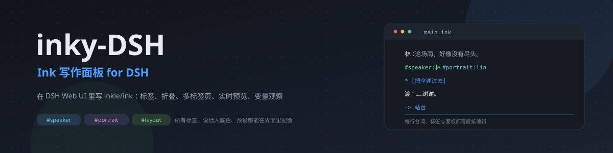
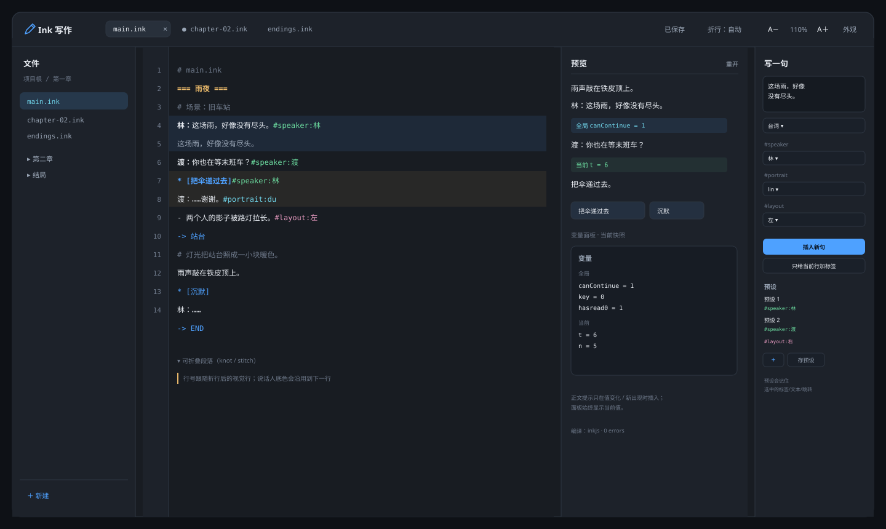
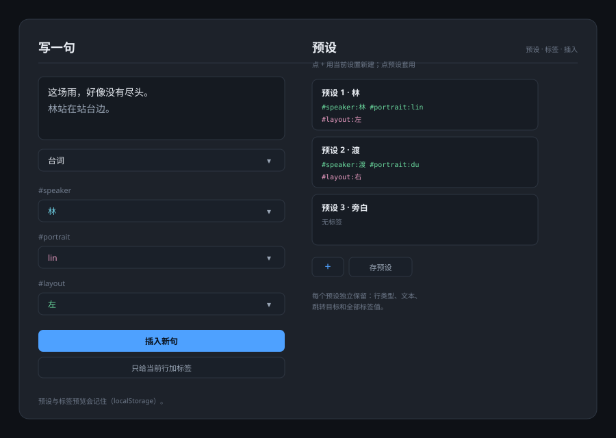
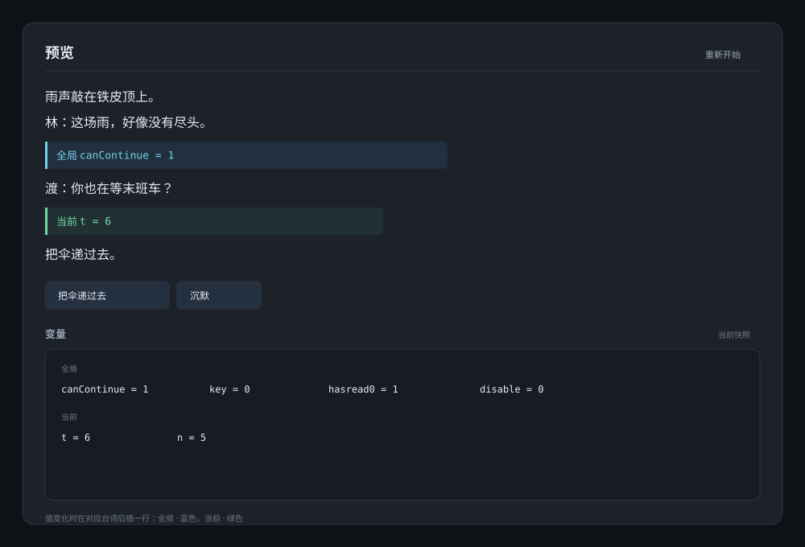

<div align="center">
  
  <h1>inky-DSH</h1>
  <p><strong>在 DSH Web UI 里写 inkle/ink 剧本</strong><br />
  标签选择 · 折叠 · 多标签页 · 实时预览 · 变量观察 · 蓝图 · 结构树</p>
  <p>
    
    
    
    
  </p>
</div>



## 简介

**inky-DSH** 是一个 DSH（DeepSeek Harness）的 Web UI 插件，把 inkle/ink 剧本编写搬进 DSH 的侧边面板。它用「透明 textarea + 语法高亮层」实现类似 Inky 的编辑体验，用项目目录里的 `.ink` 文件作为唯一数据源；保存后 Inky 会通过文件监听自动热更新，面板里的预览则由官方 inkjs 实时编译运行。

适合：

- 在 DSH 里边看剧情、边改 ink 台词；
- 用下拉菜单维护 `#speaker` / `#portrait` / `#layout` 等标签，减少手写标签错误；
- 同时打开多个 `.ink` 文件，快速在章节之间切换；
- 在预览里直接观察变量（如 `VAR canContinue = 0`）的变化。

> 下文截图均为按实际 UI 样式绘制的深色主题示意图，示例内容为演示数据。

## 功能亮点

### 编辑器

- Inky 风格语法着色：注释、`#` 标签、`->` / `<-` 跳转、关键字、数字、字符串、选项、收集点、knot 标题；
- 行号跟随软折行后的**视觉行**，长行不会横向截断；
- 按上下文自动补全：`#` 补标签键、`#key:` 补词库里的值、`->` / `<-` 补当前文件的 knot/stitch/函数名（含 `END`/`DONE`），逻辑行补变量与关键字；
- `Ctrl+Z` 撤回、`Ctrl+Y` / `Ctrl+Shift+Z` 重做，连续输入合并为一步；
- 可调字号（`Alt+滚轮`，80%–200%）、折行模式（同预览 / 自动）；
- 底部是真实 inkjs 编译器的错误/警告，点一行跳到对应行；
- 滚轮可继续滚过最后一行进入空白区；滚动后右下角出现「回到顶部」；
- 中文输入法组字期间临时显示普通文字，上屏后恢复着色；
- 编辑停止约 2 秒后，自动把未保存内容备份到项目下的 `.dsh-ink-backups/`；重新打开文件时可恢复备份。

### 说话人与标签

- `#speaker:名字` 按说话人分色，低对比底色；
- **说话人底色会沿用到紧跟其后的纯文本行**，直到新的 `#speaker`、标题、选项、跳转、逻辑、注释等结构行；
- `#speaker:` 为空/空格也算一个说话人，可单独设置颜色；
- 语法/代码行和空行一样不上底色，文字仍保留语法着色；
- 「外观 → 说话人颜色」可用下拉选择说话人，逐个改色或恢复默认，颜色会记住。

### 写一句

右侧「写一句」是一个行组装器：

- 行类型：台词、`*[...]` 一次性选项、`+[...]` 可重复选项、`-> 跳转`；
- `#speaker` / `#portrait` / `#layout` 等标签用下拉选择，也可手填自定义值；
- 「插入新句」在光标前插入整行；「只给当前行加标签」保留原文字和 `->`，只替换/追加标签；
- **预设**：默认一个，点 `+` 用当前设置新建；点预设套用；「存预设」更新；每个预设显示保存的标签预览，可删除；预设保存在 localStorage。



### 多标签页与开始面板

- 打开文件会新增标签，可同时打开多个 `.ink`；
- 标签栏与「已保存 / 折行 / 缩放」合并为同一行：标签在左、可横向滚动，状态和控件固定在右；
- 每个标签独立保留内容、未保存状态、撤销/重做、光标和滚动位置；
- 点标签上的 `×` 关闭；有未保存修改会确认；
- 关闭所有文件后显示**开始面板**：可输入项目内路径打开文件、选择文件夹切换项目；下方按「最近修改」显示文件卡片（文件名、路径、前几行预览、修改时间），点卡片直接打开；
- 打开/切换文件时，左侧文件栏自动定位到文件所在文件夹，并滚动/高亮当前文件；重新展开文件栏也会定位。

### 实时预览与变量观察

- 顶部「预览」在编辑器右侧打开预览窗，左边改、右边看；
- 正文按行淡入；所有行播完后出现选项或结局；点选项继续；「重新开始」从当前内容重播；
- 用当前编辑器内容编译，未保存的修改也会反映；
- **变量值变化时**，在对应台词后插入提示：
  - `全局 canContinue = 1`（全局 `VAR` / `LIST`，蓝色边线）
  - `当前 t = 6`（`temp` / knot 参数，绿色边线）
- 预览底部有一个可折叠的「变量」面板，实时列出全局和当前变量的当前值；停在选项时也能看到当前快照；
- 只统计剧本里自己定义的变量，不包含引擎内部状态；初始值只显示在面板里，不算变化。



### 结构、蓝图与词库

- **结构**：读取项目里所有 `.ink`，按文件列出 knot、stitch、函数、`INCLUDE`、`VAR`/`CONST`/`LIST` 和跳转目标；跳转目标跨文件解析，找不到的标黄；
- **蓝图**：当前文件的节点图，knot / stitch / 函数 / 文件开头为节点，`->` / `<-` 为连线；滚轮缩放、中键平移、框选、整体拖动、双击跳转；
- **词库**：自动扫描项目内已有的 `#key:value`，按 key 汇总；自定义值可记入本地词库。

### 外观与界面

- 浅色/深色主题强调色分别设置，自动跟随当前主题；
- 按钮显示方式：文字+图标 / 纯图标；
- 语言：自动 / 中文 / English；
- 折叠查看开关、折叠标题高亮色；
- 说话人颜色、行背景标识开关与强度；
- 「界面」按钮打开「界面按钮」窗口，用勾选决定哪些动作按钮显示在工具栏；外观和界面按钮始终保留；可全选/全不选/恢复默认；
- 工具栏可放在左侧或顶部，可拖动位置、收起/展开左右栏、拖动调宽。

### 自动备份

- 编辑停止约 2 秒后，把当前未保存内容写入项目下的 `.dsh-ink-backups/`（JSON，按文件路径编码）；
- 重新打开文件或回到插件时，如果备份比磁盘文件新且内容不同，会提示「恢复备份」或「保留当前」；
- 关闭标签会清掉该文件的自动备份。

## 安装

### 前置

- 已安装 **DSH Desktop / DSH Web**；
- 可选：安装 [Inky](https://github.com/inkle/inky)（用于从面板启动 Inky 和文件热更新；预览本身使用仓库内置的 inkjs，不依赖 Inky）。

### 方式 A：把 GitHub 地址直接交给 DSH（推荐，现在可用）

DSH 的插件安装器支持 **git URL / GitHub 地址**，不需要先发布 npm。打开 DSH 的「插件」页，点安装，填入：

```text
https://github.com/keyiyan2/inky-DSH.git
```

也可以填不带 `.git` 的仓库地址：

```text
https://github.com/keyiyan2/inky-DSH
```

DSH 会从 GitHub 拉取仓库，读取 `package.json` 里的 `dsh.bundle`，安装并应用 `cordis.patch.yml`。安装完成后：

1. 在插件列表启用 `inky-dsh`（入口 id 是 `dsh-ink`）；
2. 配置 `projectDir` 为你的 Ink 项目目录（见下方配置表）；
3. 刷新 DSH，在侧边栏点 Ink（笔尖）图标。

> 从 git 安装可能比 npm 慢（要拉取仓库），DSH 的插件管理器可能把它放到后台任务；等安装完成后再启用。

### 方式 B：从 npm 安装（发布后）

本仓库已按 npm 包准备，包名 **`inky-dsh`**。发布到 npm 后，在 DSH 的插件管理 / 插件市场里安装 `inky-dsh`，启用后配置 `projectDir` 即可。

> 如果 npm 上还搜不到 `inky-dsh`，说明维护者尚未发布，请用方式 A 或 C；发布后即可用一条包名安装。

### 方式 C：从 GitHub 手动安装（旧版 DSH 兜底）

如果当前 DSH 的插件安装器不接受 git URL：

1. 克隆仓库：

```bash
git clone https://github.com/keyiyan2/inky-DSH.git
```

2. 把仓库放进当前 DSH profile 的 `plugins/inky-dsh`：

```text
%USERPROFILE%\.dsh\profiles\<profile>\plugins\inky-dsh
```

例如 Windows 下：

```powershell
Copy-Item -Recurse .\inky-DSH "$env:USERPROFILE\.dsh\profiles\desktop\plugins\inky-dsh"
```

3. 刷新 / 重启 DSH，在插件列表里启用 `inky-dsh`。如果使用自定义 profile 的组合文件，把仓库里的 `cordis.patch.yml` 合并进 profile，或在插件设置里添加同样的配置：

```yaml
- insert:
    - id: dsh-ink
      name: 'inky-dsh'
      config:
        projectDir: 'D:\你的Ink项目'
        inkyPath: 'D:\inky\Inky_windows_64\Inky.exe'
```

4. 打开 DSH Web UI，在侧边栏点击 Ink（笔尖）图标；第一次使用先设置项目目录。

### 发布（维护者）

```bash
npm login
npm publish
```

仓库包含 `.github/workflows/publish.yml`：在 GitHub 创建 Release（或手动触发 workflow）时自动发布到 npm。需要在仓库 Secrets 里配置 `NPM_TOKEN`（npm Automation token）；首次发布前先确认包名 `inky-dsh` 仍可用。

## 配置

| 配置项 | 默认值 | 说明 |
| --- | --- | --- |
| `projectDir` | `D:\inky\project` | Ink 项目根目录；面板只读写该目录内的 `.ink` |
| `inkyPath` | `D:\inky\Inky_windows_64\Inky.exe` | 「在 Inky 打开」使用的可执行文件；可留空 |
| `maxFileBytes` | 4 MB | 单个文件读写上限 |

也可以在面板里点「切换目录」临时切换项目（记在浏览器 localStorage），不改 Host 配置。

## 使用说明

1. **打开/切换文件**：左侧文件栏逐级浏览，点文件夹进入、点面包屑返回；点 `.ink` 文件在右侧打开。多个文件会以标签保留。
2. **新建**：文件栏底部「新建」可建 `.ink` 文件或文件夹（面板内输入，不弹系统框）。
3. **写台词**：编辑器里直接写；给行尾加 `#speaker:名字` 等标签。`#` 后会弹出标签键补全，`#key:` 后弹出值补全。
4. **用「写一句」组装**：选行类型 → 填文本/跳转 → 选标签 → 「插入新句」或「只给当前行加标签」。
5. **保存**：`Ctrl+S` 或工具栏「保存」；Inky 监听到磁盘变化会自动重载。
6. **预览**：点顶部「预览」打开右侧预览窗；改动后约 0.7 秒自动重播到下一个选择/结尾；点选项继续。
7. **看变量**：预览正文里的 `全局` / `当前` 提示表示变量变化；底部「变量」面板显示当前快照。
8. **折叠**：行号左侧 `▾` 收起 knot/stitch 块，`▸` 展开；可见内容仍可编辑。
9. **多文件**：标签切换；关闭全部文件后从开始面板或最近文件重新打开。
10. **外观**：点「外观」调主题强调色、按钮显示方式、语言、说话人颜色等；点「界面」勾选工具栏动作按钮。

## 快捷键

| 快捷键 | 作用 |
| --- | --- |
| `Ctrl+S` | 保存当前文件 |
| `Ctrl+Z` | 撤回 |
| `Ctrl+Y` / `Ctrl+Shift+Z` | 重做 |
| `Alt+滚轮` | 缩放编辑器字号 |
| `↑` / `↓` + `Enter` / `Tab` | 补全列表选择/采纳 |
| `Esc` | 关闭补全/弹层 |

## 项目结构

```text
inky-DSH/
├── README.md
├── LICENSE
├── package.json              # inky-dsh，DSH bundle / npm 包声明
├── cordis.patch.yml          # Host 侧插入配置
├── index.js                  # Host：目录、读写、inkjs 编译、预览会话
├── client.js                 # Web UI：编辑器、标签页、面板、预览
├── icon.svg
├── locale/
│   ├── zh.json
│   └── en.json
├── vendor/inkjs/
│   ├── ink-full.mjs          # 官方 inkjs（MIT）的 vendored 构建
│   └── LICENSE.md
├── .github/workflows/
│   └── publish.yml           # Release 时自动 npm publish
└── docs/images/              # README 示意图
```

## 已知限制

- 面板依赖 DSH 的 Web UI 与 Cordis 插件运行时，不是独立桌面应用；
- 预览变量提示基于 inkjs 的变量状态比较；极少数「同一行内改了临时变量又立即离开作用域」的情况不会单独插提示（正文里通常会直接输出该值）；
- 设置、预设、说话人颜色等保存在浏览器 localStorage；清除站点数据会丢失这些 UI 偏好（不会丢失 `.ink` 文件）；
- 自动备份只针对当前编辑内容，不替代版本控制。

## 第三方与许可

- **inkjs**：官方 inkle/ink 的 JavaScript 运行时与编译器，MIT，见 [`vendor/inkjs/LICENSE.md`](vendor/inkjs/LICENSE.md)；
- 本项目：MIT，见 [`LICENSE`](LICENSE)。

## 致谢

- [inkle](https://github.com/inkle) 的 ink 与 Inky；
- DSH 的插件/UI 运行时。

---

如果这个插件对你有帮助，欢迎 Star ⭐ 或提 Issue / PR。
